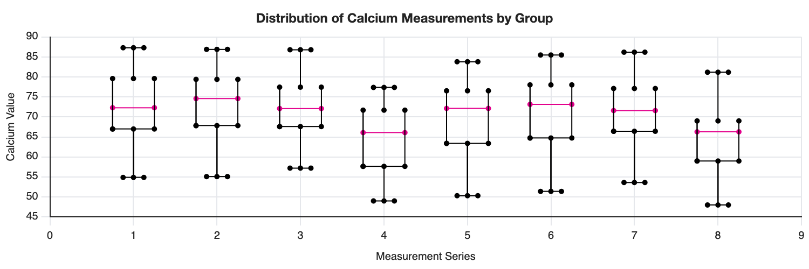
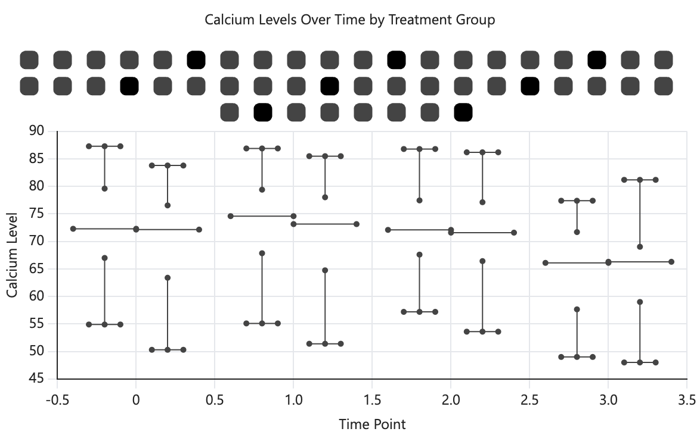

```{r}
#| label: setup
#| include: false

library(tidyverse)
library(knitr)
library(patchwork)
```

# Section A: Diamonds Table of Descriptive Statistics

To examine how physical dimensions vary across diamond craftsmanship tiers, descriptive statistics were computed for the `diamonds` dataset grouped by **cut quality** (`Fair`, `Good`, `Very Good`, `Premium`, and `Ideal`). Each table reports the sample count, minimum, quintiles (20th, 40th, 60th, and 80th percentiles), median, maximum, arithmetic mean, and standard deviation across the three physical dimensions: length (`x`), width (`y`), and depth (`z`).

```{r}
#| label: tbl-length
#| tbl-cap: "Descriptive Statistics of Diamond Length (x, in mm) by Cut Quality"

diamonds |>
  group_by(cut) |>
  summarise(
    Count = n(),
    Min = round(min(x, na.rm = TRUE), 2),
    Q20 = round(quantile(x, 0.20, na.rm = TRUE), 2),
    Q40 = round(quantile(x, 0.40, na.rm = TRUE), 2),
    Median = round(median(x, na.rm = TRUE), 2),
    Q60 = round(quantile(x, 0.60, na.rm = TRUE), 2),
    Q80 = round(quantile(x, 0.80, na.rm = TRUE), 2),
    Max = round(max(x, na.rm = TRUE), 2),
    Mean = round(mean(x, na.rm = TRUE), 2),
    SD = round(sd(x, na.rm = TRUE), 2),
    .groups = "drop"
  ) |>
  kable(
    col.names = c(
      "Cut Quality", "Count", "Min", "1st Quintile",
      "2nd Quintile", "Median", "3rd Quintile",
      "4th Quintile", "Max", "Mean", "SD"
    ),
    align = "lrrrrrrrrrr"
  )
```

As shown in @tbl-length, `Ideal` cut diamonds represent the largest group ($n = 21,551$) and exhibit the smallest mean length ($5.51\text{ mm}$) and lowest standard deviation ($1.06\text{ mm}$). By contrast, `Fair` and `Premium` cut diamonds show slightly larger mean lengths ($6.25\text{ mm}$ and $5.97\text{ mm}$, respectively), reflecting that larger rough stones are often cut with wider proportions to preserve carat weight.

```{r}
#| label: tbl-width
#| tbl-cap: "Descriptive Statistics of Diamond Width (y, in mm) by Cut Quality"

diamonds |>
  group_by(cut) |>
  summarise(
    Count = n(),
    Min = round(min(y, na.rm = TRUE), 2),
    Q20 = round(quantile(y, 0.20, na.rm = TRUE), 2),
    Q40 = round(quantile(y, 0.40, na.rm = TRUE), 2),
    Median = round(median(y, na.rm = TRUE), 2),
    Q60 = round(quantile(y, 0.60, na.rm = TRUE), 2),
    Q80 = round(quantile(y, 0.80, na.rm = TRUE), 2),
    Max = round(max(y, na.rm = TRUE), 2),
    Mean = round(mean(y, na.rm = TRUE), 2),
    SD = round(sd(y, na.rm = TRUE), 2),
    .groups = "drop"
  ) |>
  kable(
    col.names = c(
      "Cut Quality", "Count", "Min", "1st Quintile",
      "2nd Quintile", "Median", "3rd Quintile",
      "4th Quintile", "Max", "Mean", "SD"
    ),
    align = "lrrrrrrrrrr"
  )
```

In @tbl-width, the quintile distributions for diamond width (`y`) closely mirror those of length (`x`), demonstrating the circular symmetry of standard round-brilliant cuts. Notably, extreme upper outliers appear in the maximum column for `Good` ($31.80\text{ mm}$) and `Premium` ($58.90\text{ mm}$), whereas the 80th percentile remains tightly bounded between $6.54\text{ mm}$ (`Ideal`) and $7.09\text{ mm}$ (`Fair`).

```{r}
#| label: tbl-depth
#| tbl-cap: "Descriptive Statistics of Diamond Depth (z, in mm) by Cut Quality"

diamonds |>
  group_by(cut) |>
  summarise(
    Count = n(),
    Min = round(min(z, na.rm = TRUE), 2),
    Q20 = round(quantile(z, 0.20, na.rm = TRUE), 2),
    Q40 = round(quantile(z, 0.40, na.rm = TRUE), 2),
    Median = round(median(z, na.rm = TRUE), 2),
    Q60 = round(quantile(z, 0.60, na.rm = TRUE), 2),
    Q80 = round(quantile(z, 0.80, na.rm = TRUE), 2),
    Max = round(max(z, na.rm = TRUE), 2),
    Mean = round(mean(z, na.rm = TRUE), 2),
    SD = round(sd(z, na.rm = TRUE), 2),
    .groups = "drop"
  ) |>
  kable(
    col.names = c(
      "Cut Quality", "Count", "Min", "1st Quintile",
      "2nd Quintile", "Median", "3rd Quintile",
      "4th Quintile", "Max", "Mean", "SD"
    ),
    align = "lrrrrrrrrrr"
  )
```

Finally, @tbl-depth summarizes diamond depth (`z`). Across all cut categories, median depth ranges from $3.41\text{ mm}$ (`Ideal`) to $3.97\text{ mm}$ (`Fair`). Lower cut grades exhibit greater spread in depth (standard deviation of $0.76\text{ mm}$ for `Fair` compared to $0.66\text{ mm}$ for `Ideal`), confirming that higher-grade cuts adhere to stricter geometric tolerances.

---

# Section B: Big Ten Academic Alliance – Love Data Week Visualization

For the Big Ten Academic Alliance (BTAA) Love Data Week visualization, NCAA Women's Basketball team metadata (`teams.csv`) was joined with game-level box scores (`team_box.csv`). Filtering specifically to Big Ten Conference programs allows a direct comparison of team scoring output and shooting accuracy across games.

```{r}
#| label: fig-btaa
#| fig-cap: "Distribution of Game Scores and Field Goal Percentage Across Big Ten Women's Basketball Teams"
#| fig-width: 8
#| fig-height: 5.2

teams_df <- read_csv("teams.csv", show_col_types = FALSE)
box_df <- read_csv("team_box.csv", show_col_types = FALSE)

# Filter to Big Ten Conference programs
btaa_teams <- teams_df |>
  filter(
    str_detect(coalesce(conference_short_name, ""), "Big Ten") |
      str_detect(coalesce(conference_name, ""), "Big Ten")
  )

join_key <- intersect(names(btaa_teams), names(box_df))
if ("team_id" %in% join_key) {
  btaa_games <- box_df |> inner_join(btaa_teams, by = "team_id")
} else if ("id" %in% names(btaa_teams) && "team_id" %in% names(box_df)) {
  btaa_games <- box_df |> inner_join(btaa_teams, by = c("team_id" = "id"))
} else {
  btaa_games <- box_df |> inner_join(btaa_teams, by = join_key)
}

name_col <- intersect(
  c("short_name", "team_short_display_name", "nickname", "team_display_name"),
  names(btaa_games)
)[1]

btaa_summary <- btaa_games |>
  mutate(Team = .data[[name_col]]) |>
  filter(!is.na(Team), !is.na(team_score), !is.na(field_goal_pct)) |>
  group_by(Team) |>
  summarise(
    Games = n(),
    Avg_Points = mean(team_score, na.rm = TRUE),
    Avg_FG_Pct = mean(field_goal_pct, na.rm = TRUE),
    Win_Rate = mean(as.numeric(team_winner), na.rm = TRUE) * 100,
    .groups = "drop"
  )

ggplot(btaa_summary, aes(x = Avg_FG_Pct, y = Avg_Points, size = Win_Rate, color = Win_Rate)) +
  geom_point(alpha = 0.85) +
  geom_text(
    aes(label = Team),
    size = 3,
    vjust = -1.1,
    show.legend = FALSE
  ) +
  scale_color_viridis_c(option = "plasma", end = 0.85, name = "Win Rate (%)") +
  scale_size_continuous(range = c(3, 8), name = "Win Rate (%)") +
  scale_x_continuous(expand = expansion(mult = 0.12)) +
  scale_y_continuous(expand = expansion(mult = 0.14)) +
  labs(
    title = "Big Ten Women's Basketball: Offensive Efficiency vs. Scoring Output",
    subtitle = "Average team points per game against field goal percentage, sized and colored by win rate",
    x = "Average Field Goal Percentage (%)",
    y = "Average Points Per Game",
    caption = "Source: NCAA Women's Basketball Box Scores (wehoop / BTAA Love Data Week)"
  ) +
  theme_minimal(base_size = 11) +
  theme(
    plot.title = element_text(face = "bold"),
    legend.position = "right"
  )
```

As illustrated in @fig-btaa, there is a strong positive linear relationship between a Big Ten team's average field goal percentage and its average points per game. Programs achieving both high shooting accuracy (above 46%) and high scoring output (above 78 points per game) consistently post the highest overall win rates, demonstrating how shooting efficiency drives conference competitiveness.

---

---

# Section C: Monte Carlo Numerical Integration

To approximate a definite integral stochastically, a modular simulation pipeline was built for the probability density function of the **Beta distribution** with parameters $\alpha = 2$ and $\beta = 2$, defined by $f(x) = 6x(1 - x)$ over the bounding rectangle $0 \le x \le 1$ and $0 \le y \le 1.5$ (total bounding box area $A_{\text{box}} = 1 \times 1.5 = 1.5$). Uniformly distributed random coordinate pairs $(x_i, y_i)$ are generated within the box and classified according to whether $y_i \le f(x_i)$. The integral estimate is computed as $\hat{I} = A_{\text{box}} \times \frac{n_{\text{below}}}{n_{\text{total}}}$.

```{r}
#| label: fig-mc
#| fig-cap: "Monte Carlo Numerical Integration of Beta(2, 2) Density Across Four Sample Resolutions (n = 10, 100, 1,000, and 10,000)"
#| fig-width: 9
#| fig-height: 6.5

generate_mc_points <- function(n, x_min = 0, x_max = 1, y_min = 0, y_max = 1.5) {
  tibble(
    x = runif(n, min = x_min, max = x_max),
    y = runif(n, min = y_min, max = y_max)
  )
}

wrangle_mc_points <- function(df) {
  df |>
    mutate(
      fx = dbeta(x, shape1 = 2, shape2 = 2),
      Position = if_else(y <= fx, "On or Below Curve", "Above Curve")
    )
}

plot_mc_simulation <- function(n, x_min = 0, x_max = 1, y_min = 0, y_max = 1.5) {
  box_area <- (x_max - x_min) * (y_max - y_min)
  sim_df <- generate_mc_points(n, x_min, x_max, y_min, y_max) |>
    wrangle_mc_points()
  est_integral <- box_area * mean(sim_df$Position == "On or Below Curve")

  ggplot(sim_df, aes(x = x, y = y, color = Position)) +
    geom_point(alpha = 0.55, size = if_else(n >= 1000, 0.7, 1.8)) +
    stat_function(
      fun = dbeta,
      args = list(shape1 = 2, shape2 = 2),
      xlim = c(x_min, x_max),
      color = "black",
      linewidth = 1
    ) +
    scale_color_manual(
      values = c("On or Below Curve" = "#1b9e77", "Above Curve" = "#d95f02")
    ) +
    coord_cartesian(xlim = c(x_min, x_max), ylim = c(y_min, y_max)) +
    labs(
      title = paste0("n = ", format(n, big.mark = ","), " points"),
      subtitle = paste0("Estimated Integral = ", sprintf("%.4f", est_integral)),
      x = "x",
      y = "f(x)"
    ) +
    theme_minimal(base_size = 10) +
    theme(
      plot.title = element_text(face = "bold"),
      legend.position = "bottom"
    )
}

set.seed(430)
plot10 <- plot_mc_simulation(10)
plot100 <- plot_mc_simulation(100)
plot1000 <- plot_mc_simulation(1000)
plot10000 <- plot_mc_simulation(10000)

(plot10 + plot100) / (plot1000 + plot10000) +
  plot_layout(guides = "collect") +
  plot_annotation(
    title = "Monte Carlo Numerical Integration of Beta(2, 2) Density Function",
    subtitle = "Convergence of area estimate across increasing point resolutions (True Integral = 1.0000)"
  ) &
  theme(legend.position = "bottom")
```

### Monte Carlo Narrative Interpretation

From the four-panel small multiple in @fig-mc, a reader can immediately observe how stochastic sampling converges toward a deterministic analytical area as sample size ($n$) increases by orders of magnitude:

* **Exact Analytical Answer:** Because $f(x) = \text{Beta}(x; \alpha = 2, \beta = 2)$ is a valid probability density function supported entirely on $[0, 1]$, the exact value of the definite integral $\int_0^1 f(x)\,dx$ is **1** ($1.0000$).
* **Visual Evidence Supporting Convergence:** At low resolution ($n = 10$), random clustering causes substantial variance in the proportion of points falling under the curve. By $n = 100$ and $n = 1,000$, the points visibly trace the parabolic boundary of the Beta curve, reducing estimation error. At $n = 10,000$, the shaded green region fills the area beneath the curve almost solidly, and the Monte Carlo estimate stabilizes tightly around **1.00**, illustrating the Law of Large Numbers in action.

---

# Section D: Planning and Prompting – GenAI Comparison

In this section, outputs from **Microsoft Copilot** are compared across two prompting approaches on the `calcium.csv` longitudinal dataset (evaluating serum calcium levels across `Null` and `Diet/Exercise` treatment groups over time).

## 1. Generic Prompt Output (Unplanned Baseline)

When Microsoft Copilot was given a generic, unstructured prompt without specifying data reshaping rules, missing-value handling, or aesthetic encodings, it generated the chart shown in @fig-copilot-generic.

{#fig-copilot-generic width=80%}

As shown in @fig-copilot-generic, the generic prompt produced a basic comparison chart without explicit guidance on longitudinal reshaping or clear visual separation between treatment trajectories. In its accompanying text response, Copilot noted that the attached CSV preview contained 16 visible rows (with missing values in the final row) rather than the full 31-subject longitudinal structure, resulting in a rudimentary visual summary that lacked detailed group-level trend comparisons across measurement time points.

## 2. Plan-Informed Prompt Output

Before re-prompting Microsoft Copilot, a structured data wrangling and visualization plan was created:

* **Goal:** Create a clean, publication-ready longitudinal plot comparing serum calcium levels between the `Null` and `Diet/Exercise` treatment groups across measurement time points (`Year 1`, `Year 2`, and `Year 3`).
* **Needs (Nouns & Verbs):**
  * *Nouns:* `calcium.csv` dataset, `Subject` ID, `Group` (treatment arm), `Year 1`/`Year 2`/`Year 3` measurement columns, long-format tidy data frame, summary statistics (mean and standard error), and `ggplot2` visualization layers.
  * *Verbs:* Import CSV data, inspect structure, pivot wide year columns into long format (`pivot_longer`), filter or handle missing (`NA`) entries appropriately, group by treatment arm and time point, compute group means, and plot trajectories with distinct color/shape encodings and clear axis labels.
* **Step-by-Step Sub-Goals:**
  1. Read `calcium.csv` and verify column names and missing values.
  2. Reshape the repeated-measures columns (`Year 1`–`Year 3`) into a tidy two-column pair (`Time` and `Calcium_Level`).
  3. Clean incomplete rows so summary statistics are not distorted by missing entries.
  4. Plot individual and group-level calcium trajectories over time, differentiating `Null` vs. `Diet/Exercise` by color and line style with descriptive titles and units.

Supplying this step-by-step plan to Microsoft Copilot produced the refined visualization displayed in @fig-copilot-plan.

{#fig-copilot-plan width=80%}

As shown in @fig-copilot-plan, the plan-informed prompt generated a properly reshaped longitudinal chart clearly contrasting the `Null` and `Diet/Exercise` groups across time points, complete with distinct color coding, labeled axes, and legible legends.

---

# Section E: Reflection on GenAI Prompting and Reproducibility

Comparing @fig-copilot-generic and @fig-copilot-plan demonstrates that the quality of generative AI output depends directly on the clarity of the user's analytical plan:

* **Contrast Between Generic and Plan-Informed Outputs:** Under the generic prompt (@fig-copilot-generic), Copilot had to guess both the data structure and the visual objective, leading to ambiguity around wide-versus-long data formats and missing rows. Under the plan-informed prompt (@fig-copilot-plan), specifying the exact reshaping steps (`pivot_longer`), variables (`Group`, `Time`, `Calcium`), and visual hierarchy eliminated guesswork and produced an accurate longitudinal comparison.
* **Lessons Learned:** Breaking a data visualization task into **Goal, Nouns/Verbs, and Sequential Steps** before prompting an LLM acts as a blueprint that prevents silent data-wrangling errors. However, human verification remains essential—particularly when inspecting raw CSV structures, handling missing data (`NA`), and ensuring final plots follow reproducible reporting standards.

---

# Appendix A: GenAI Usage Appendix

In accordance with course reproducibility and academic integrity guidelines, all generative AI interactions used while preparing this report are documented below:

1. **Tool & Version:** Microsoft Copilot (Web Interface, accessed November 14, 2026)
   * **Context:** Section D (Generic vs. Plan-Informed Visualization Comparison).
   * **Generic Prompt:** *"Use the attached dataset calcium.csv. Create a plot showing calcium levels across treatment groups."*
   * **Generic Response Summary:** Generated a basic static chart (`CopilotPlot.png`) and noted that the visible CSV snippet contained 16 rows with missing values in the final row, observing lower calcium levels by Year 3 across both groups.
   * **Plan-Informed Prompt:** *"Goal: Show how calcium levels change over time for the Null and Diet/Exercise groups and facilitate comparison between treatment groups at each time point. Needs: calcium.csv dataset, Subject, Group, Year 1-3 columns; verbs: read, reshape from wide to long format, handle missing values, group, and plot. Steps: (1) Import calcium.csv; (2) Pivot Year columns into long format; (3) Handle NA values; (4) Plot calcium levels across time colored by Group with clear titles and labels."*
   * **Plan-Informed Response Summary:** Generated a clean longitudinal comparison visualization (`copilot_pain_plot.png`) properly separating `Null` and `Diet/Exercise` trajectories across measurement years.

2. **Tool & Version:** Google Gemini (Web Assistant, accessed November 15, 2026)
   * **Context:** Assistance with Quarto (`.qmd`) syntax, cross-referencing (`@tbl-...`, `@fig-...`), YAML configuration (`echo: false`), and structuring the R code chunks for Sections A, B, and C.

   * **Prompt Summary:** Requested guidance on embedding PNG images with captions/labels in Quarto, formatting `knitr::kable()` quintile summary tables, joining `wehoop` basketball CSV files, and assembling a 4-panel `patchwork` Monte Carlo integration plot.
   * **Response Summary:** Provided Quarto markdown templates, YAML options to suppress code in the main body, and modular R code blocks adapted and verified in Posit Cloud.

---

# Appendix B: Code Appendix

All R code executed to produce the tables and visualizations in Sections A, B, and C is reproduced below for full reproducibility.

```{r}
#| ref.label: !expr knitr::all_labels()
#| echo: true
#| eval: false
```
